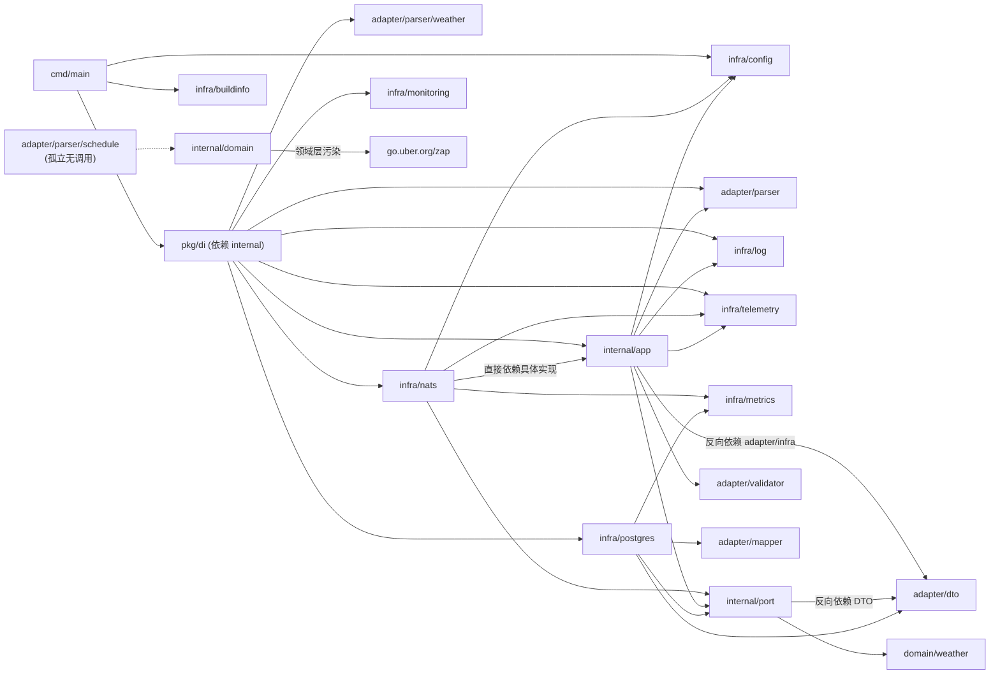
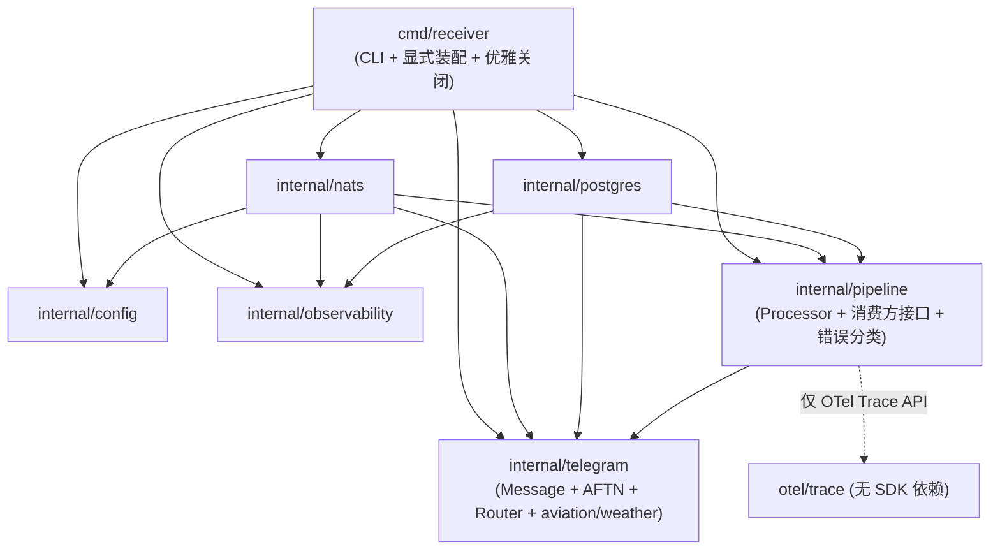

# go-caatsm 软件架构设计方案

## 1. 文档定位与演进原则

本文档是 `go-caatsm`（Civil Aviation Authority Telegram Message Processor）的**唯一权威架构设计文档（Single Source of Truth）**。

> **演进状态（已完成重构）**：本文档提出的 Phase 0 止血修复、Phase 1 三层高内聚收敛与 Phase 2 清理固化已全部在代码库落地完成；下文第 2 节保留“重构前基线（As-Is Historical Baseline）”与第 4.1 节映射表，便于追溯改造脉络与历史缺陷定位。

为避免“文档宣称的理想架构”与“代码实际演进形态”长期脱节，本文档严格区分两个基线：
- **As-Is（重构前历史基线）**：完整记录重构前仓库中 22 个包的实际结构、调用链与已定位缺陷；
- **To-Be（已落地 3 层目标架构）**：针对当前电报解析与流式管道服务特征收敛后的 Go 惯用 3 层高内聚架构及分阶段验收结果。

### 1.1 架构取舍：为什么告别教条式 Clean Architecture

当前项目名义上采用 7 层 Clean Architecture（`domain / port / app / adapter / dto / mapper / infra` + `pkg/di`），但在“协议解析 + 单向流式管道”这类服务上产生了明显的负收益：
1. **核心领域与适配器倒挂**：在电报处理系统中，AFTN 报头拆解、ICAO Doc 4444 报文解析、METAR/TAF 词法分析与协议校验本身就是核心业务规则，却被划入 `internal/adapter/`，导致 `internal/domain/` 退化为贫血结构体，甚至出现领域 `Validate()` 与解析器完全脱节的问题；
2. **依赖倒置名存实亡**：核心处理信封 `ParsedTelegram` 落在 `internal/adapter/dto`，逼着 `internal/port` 和 `internal/app` 反向依赖 `adapter`；`internal/domain/sita.go` 直接依赖 `zap`；`internal/infra/nats` 直接依赖具体类型 `*app.MessageProcessor`；
3. **违反 Go 接口惯用法**：Go 提倡在**使用方定义最小接口**（*Accept interfaces, return structs*），集中式 `internal/port/` 只放了 3 个零散接口文件，而 `Parser` 与 `Recorder` 仍散落在 `adapter` 和 `infra` 中；
4. **Google Wire 收益低于维护成本**：服务总共装配约十余个组件，引入 `pkg/di` 代码生成反而带来了 `.gitignore` 冲突、与 `internal/` 的目录语义倒挂，以及未接通 cleanup 导致退出时漏关数据库连接池的问题。

### 1.2 保留的优秀设计 vs 淘汰的形式主义负担

| 维度 | 决策 | 说明 |
|---|---|---|
| **核心解析零外部 IO 依赖** | **保留并强化** | 电报解析、模型定义与协议校验纯内存执行，不接触 NATS/DB/Config/全局日志，支持毫秒级单测、Fuzz 与 Benchmark |
| **流水线依赖小接口** | **保留并归位** | 编排层通过最小接口依赖存储、发布器、解析器与遥测记录器，接口下沉到使用方包内，无需 Docker 即可完整单测编排逻辑 |
| **JetStream 持久化与 DLQ** | **保留并修复** | 保留拉取消费、显式 ACK/NAK 退避与死信队列机制，修复流拓扑混用、静默丢消息与生产环境建流管控 |
| **TimescaleDB + Raw 审计表** | **保留并优化** | 保留主表 `aviation.telegrams` 与失败原始表 `aviation.telegrams_raw` 的审计设计，优化去重索引与映射位置耦合 |
| **全链路可观测性** | **保留并收敛** | 保留 Zap 结构化日志、OpenTelemetry Tracing/Metrics、Prometheus `/metrics` 与 `/livez` `/readyz` 探针，合并重复实现 |
| **`internal/port/` 全局接口包** | **淘汰** | 下沉为各使用方包内的最小接口契约（如 `pipeline/ports.go`） |
| **`adapter/dto` + `adapter/mapper`** | **淘汰** | 统一核心 `Message` 信封进入 `internal/telegram`；PostgreSQL 17 列行映射下沉至 `internal/postgres` 内部 |
| **`adapter/{parser,validator}` 外壳** | **淘汰** | 解析与协议校验回归核心业务包 `internal/telegram` |
| **`pkg/di`（Wire）与 `pkg/utils`** | **淘汰** | 迁出空目录与 `pkg/di`，在 `cmd/receiver` 中采用显式手写装配与 `defer` 生命周期管理 |

---

## 2. 重构前代码架构（As-Is Historical Baseline）

> 本节记录本次 3 层重构前仓库的历史代码快照（约 9,100 行非测试 Go 代码，22 个包），用于对照说明改造动机。当前代码已全面迁移至第 3 节所述的 3 层结构。

### 2.1 当前包结构与职责

- **入口与工具（`cmd/`）**：
  - `cmd/main/main.go`：基于 `urfave/cli/v2` 的 CLI（`listen` 命令），加载配置、应用 CLI 覆盖、**直接初始化 OTel SDK**，通过 `pkg/di.InitializeAppWithConfig` 装配并启动监控服务与消费循环。
  - `cmd/seed-telegrams/main.go`：测试造数工具，生成 `ARR`/`DEP`/`CNL`/`DLA`/`FPL` 报文发布到 Core NATS 或 JetStream（当前不支持气象报文，也不支持直写 Postgres）。
- **领域层（`internal/domain/`）**：
  - 航空报文模型：`arr.go`、`dep.go`、`cnl.go`、`dla.go`、`fpl.go`（在用）；`aln.go`、`chg.go`、`cpl.go`、`sita.go`、`pln.go`（`ScheduleLine`，目前无解析管线接入）；`aviation.go`（纯注释残留文件）。
  - 气象模型子包：`internal/domain/weather/`（`types.go`、`elements.go`、`errors.go`）。
- **端口层（`internal/port/`）**：
  - `repository.go`（`Repository` 接口，依赖 `adapter/dto`）、`publisher.go`（`Publisher` 接口，`Publish(message interface{}) error`）、`weather_parser.go`（`WeatherParser` 接口）。
- **应用层（`internal/app/`）**：
  - `processor.go`：`MessageProcessor.Handle(ctx, raw, msgID)` 编排解析、可选 AFTN 校验、落库与发布。
  - `errors.go`：`PermanentError`、`Permanent()`、`IsPermanent()`。
- **适配器层（`internal/adapter/`）**：
  - `dto/telegram.go`：`ParsedTelegram` 与 `MessageStatus`（`unknown`/`parsed`/`header_error`/`body_error`/`aftn_error`）。
  - `mapper/`：`TelegramMapper`，将 `ParsedTelegram` 转为 PostgreSQL 17 列位置切片 `[]interface{}`。
  - `validator/aftn.go`：`ValidateTelegram` 及字段校验函数。
  - `parser/`：`Parser` 接口、`CompositeParser`（先匹配 `WeatherParser`，失败后回退 `AviationParser`）；子包 `aviation/`、`weather/`；以及孤立子包 `schedule/`（未被任何生产包引用）。
- **基础设施层（`internal/infra/`）**：
  - `config/`：Koanf 加载 `configs/config.{GO_ENV}.toml` + `CAATSM_*` 环境变量覆盖与校验。
  - `log/`：Zap + Lumberjack 日志初始化与 `MessageFields` 结构化契约。
  - `metrics/`：全局单例 Prometheus 注册表与指标记录函数。
  - `telemetry/`：`Recorder` 接口（noop / composite / prom / otel）及未被主程序调用的 `otel.go`。
  - `monitoring/`：`/livez`、`/healthz`、`/readyz` 与 `/metrics` HTTP 服务。
  - `nats/`：JetStream `Consumer`、`ConsumerMonitor`、`Publisher`、`defaultDLQHandler`。
  - `postgres/`：`pgxpool.Pool` 连接池与 `Repository`（`InsertOne` / `InsertBatch` / `InsertRaw`）。
  - `buildinfo/`：构建期注入的版本、Commit 与时间变量。
- **装配层（`pkg/`）**：
  - `pkg/di/`：`wire.go` 与 `wire_gen.go`（依赖 `internal/*`）。
  - `pkg/utils/`：空目录。

### 2.2 当前实际依赖图与运行流向



当前运行时消息处理流：
`JetStream Pull (Consumer.Start)` → `Consumer.processMsg` → `MessageProcessor.Handle` → `CompositeParser.Parse` →（若配置启用）`validator.ValidateTelegram` → `postgres.Repository.InsertOne` → `nats.Publisher.Publish` → `msg.Ack()` / `DLQ + Ack()` / `NakWithDelay()`。

### 2.3 当前代码已知偏差清单（Known Gaps）

| 类别 | 问题位置 | 现状与风险 |
|---|---|---|
| **架构违背** | `internal/domain/sita.go` | 领域层直接引入 `go.uber.org/zap` |
| **架构违背** | `internal/port/repository.go` | 端口层依赖外层 `adapter/dto`，`Parser` 与 `Recorder` 散落在 `adapter`/`infra` |
| **架构违背** | `internal/app/processor.go` | 应用层直接依赖 `adapter/{dto,parser,validator}` 与 `infra/{config,log,telemetry}` |
| **架构违背** | `internal/infra/nats/consumer.go` | 基础设施直接依赖具体类型 `*app.MessageProcessor` 与 `app.IsPermanent` |
| **架构违背** | `pkg/di/wire.go` | `pkg/` 公共目录依赖 `internal/`，且未返回 cleanup 关闭 `pgxpool.Pool` |
| **正确性缺陷** | `internal/app/processor.go:127-132` | `parseErr != nil \|\| !parsed.Parsed` 分支内无判空直接调用 `parseErr.Error()`，存在 Nil Panic 风险 |
| **指标失真** | `internal/app/processor.go` & `telemetry.go` | 处理耗时重复使用 `ParsedAt.Sub(receivedAt)` 仅反映解析耗时；发布失败触发 `RecordFailure("publisher")` 双倍计数；`RecordRetry`、`RecordJSAPICall` 等指标未接入 |
| **Trace 断裂** | `internal/port/publisher.go` & `processor.go` | `Publish(any)` 无 `context.Context`，`pubSpan` 上下文被丢弃，无法向 NATS Header 传播 Trace |
| **配置映射失效** | `internal/infra/config/config.go:205-209` | `CAATSM_` 环境变量把所有 `_` 转为 `.`，导致 `batch_size`、`enable_metrics`、`validation_enabled` 等含下划线字段无法通过环境变量覆盖 |
| **脚本冲突** | `Taskfile.yml:48,249` | `dev-run` 仍设置 `CAATSM_NATS_MODE=core`，与 `config.go` 强制仅支持 `jetstream` 冲突导致启动校验失败 |
| **AFTN 校验冲突** | `internal/adapter/validator/aftn.go` | 校验地址为 4 位字符，但 ICAO AFTN 报文与种子工具使用 8 位地址（如 `ZBBBZPZX`）；气象报设置 12 位 `DateTime` 会与 6 位 `DDHHMM` 校验冲突；单错误也包装成 `AFTNValidationErrors` 导致指标标签恒为 `multiple_errors` |
| **JetStream 拓扑** | `internal/infra/nats/consumer.go:276-328` | 将输入、输出、DLQ 三个主题全部绑定到同一个 `WorkQueuePolicy` Stream（限制多下游消费且配额耦合）；生产环境仍无条件调用 `AddStream`/`AddConsumer`；忽略 `DeliverPolicy`、`CredentialsFile` 与 `User/Password` |
| **DLQ 数据丢失** | `internal/infra/nats/consumer.go:223-226` | 忽略 `RouteToDLQ` 返回错误后依然直接 `msg.Ack()` |
| **关闭超时错位** | `cmd/main/main.go:219` & `consumer.go:135` | `sub.Fetch` 未传递 `ctx` 最长阻塞 `2s`，而 `main.go` 仅等待 `1.5s` 即报超时告警；`Consumer.Shutdown(ctx)` 忽略 `ctx` |
| **数据库效率** | `internal/infra/postgres/repository.go` | `InsertBatch` 在生产未调用；`InsertOne` 前每次额外执行无时间窗口条件的 `SELECT 1` 去重且无 `(message_id, date_time)` 联合索引，在 hypertable 上可能全 chunk 扫描 |
| **死代码与反优化** | 多处文件 | `aviation/regex_timeout.go` 对 RE2 引擎加 goroutine 超时包装；`aviation/tokenizer.go` 每条分词却被解析器丢弃；`telemetry/otel.go`（266 行）未接入而 `cmd/main` 重复实现；`parser/schedule`、`domain/{aln,chg,cpl,sita}`、`weather/normalize.go`、`nats/utils.go` 大量未用代码 |
| **测试与工程卫生** | `test/integration/` & `schedule/` & `.gitignore` | `test/integration` 两个测试文件因旧接口签名与已移除的管理器引用导致**无法编译**；`schedule_parser_test.go` 缺 `RunSpecs` 静默跳过 572 行测试；`.gitignore` 错误忽略了 `go.sum` |

---

## 3. 目标架构设计方案（To-Be：Go 惯用 3 层高内聚架构）

新架构保留“核心纯内存可测、外设可 Mock、NATS/TimescaleDB 可靠性、全链路可观测”的优点，将现有 22 个碎包收敛为 **8 个高内聚包**，按 **核心领域层 → 管道编排层 → 基础设施与入口层** 三层严格单向依赖组织。

### 3.1 目标目录结构

```text
cmd/
├── receiver/                 # 主程序入口 + CLI + 显式依赖装配 + 优雅关闭（替代 cmd/main 与 pkg/di）
└── seed-telegrams/           # 开发测试发报工具（统一支持航空与气象样例）

internal/
├── telegram/                 # 【第 1 层：核心业务与协议层】（纯 Go，仅允许标准库，零 IO/日志/配置依赖）
│   ├── message.go            # 统一 Message 信封、MessageStatus（补齐 json tag）、解析错误定义
│   ├── aftn.go               # AFTN 报头解析与协议校验（8 位地址、6 位时间，仅作用于 AFTN 报文）
│   ├── router.go             # 复合解析路由（明确区分格式识别与解析失败，不再吞错回退）
│   ├── aviation/             # ARR / DEP / CNL / DLA / FPL 模型 + 解析 + Validate（同包高内聚）
│   └── weather/              # METAR / SPECI / TAF 模型 + 解析 + Validate（去 stuttering 命名）
│
├── pipeline/                 # 【第 2 层：应用编排层】（仅依赖 internal/telegram）
│   ├── ports.go              # 消费方定义的最小接口：Parser, Validator, Store, Publisher, Recorder
│   ├── processor.go          # Parse -> Validate -> Store -> Publish 编排与完整端到端耗时统计
│   └── errors.go             # PermanentError / TransientError 错误分类契约
│
└── 【第 3 层：基础设施层】（依赖 internal/telegram 与 internal/pipeline）
    ├── nats/                 # JetStream Consumer（依赖 Handler 接口）、Publisher、DLQ、ConsumerMonitor
    ├── postgres/             # TimescaleDB Store 实现，内部具名结构体行映射（取代 adapter/mapper）
    ├── config/               # Koanf 配置加载（修复环境变量映射、支持无文件纯环境变量启动）与校验
    └── observability/        # 统一 Zap logger、单一 OTel SDK 初始化、Prometheus + /livez /readyz /metrics
```

### 3.2 目标依赖方向与约束矩阵



强制包边界规则（可通过 CI 中的 `go list` 或 `depguard` 校验）：
1. `internal/telegram/...`：**仅允许依赖 Go 标准库**，严禁引入 `zap`、`config`、`nats`、`pgx`、`otel`。
2. `internal/pipeline`：仅允许依赖 `internal/telegram`、Go 标准库及轻量 OTel Trace API（不依赖任何 `internal/{nats,postgres,config,observability}`）。
3. `internal/nats` 与 `internal/postgres`：允许依赖 `internal/telegram`、`internal/pipeline`（用于实现/调用接口与错误分类），禁止互相依赖。
4. `cmd/receiver`：唯一允许装配所有具体实现的入口，通过 `defer` 或统一 `cleanup()` 确保按反序关闭 `Consumer` → `NATS Conn` → `pgxpool.Pool` → `Monitoring Server` → `OTel Provider` → `Logger.Sync()`。

### 3.3 关键接口契约设计（消费方定义原则）

所有核心接口由使用方（`pipeline` / `nats`）定义，参数显式传递 `context.Context` 并消除 `any`：

```go
// internal/pipeline/ports.go
package pipeline

import (
    "context"
    "time"
    "caatsm/internal/telegram"
)

type Parser interface {
    Parse(raw string) (*telegram.Message, error)
}

type Validator interface {
    Validate(msg *telegram.Message) error
}

type Store interface {
    InsertOne(ctx context.Context, msg *telegram.Message) error
    InsertBatch(ctx context.Context, msgs []*telegram.Message) error
    InsertRaw(ctx context.Context, msg *telegram.Message) error
}

type Publisher interface {
    Publish(ctx context.Context, msg *telegram.Message) error
}

type Recorder interface {
    RecordProcessingResult(ctx context.Context, status, category string, elapsed time.Duration)
    RecordPublishFailure(ctx context.Context, category string)
    RecordFailure(stage string)
    RecordMessageHandled(ctx context.Context, stream, consumer, result string, elapsed time.Duration)
    RecordRetry(ctx context.Context, stream, consumer, reason string)
    RecordDLQMessage(ctx context.Context, stream, consumer string)
    RecordDLQPublishFailure(ctx context.Context, stream, consumer string)
    RecordJSAPICall(operation string)
    RecordAFTNValidationError(ctx context.Context, errorType string)
}
```

```go
// internal/nats/consumer.go（使用方定义处理契约，不再依赖具体 *app.MessageProcessor）
type MessageHandler interface {
    Handle(ctx context.Context, raw []byte, msgID string) error
}
```

### 3.4 关键子系统改造设计

1. **编排管线与错误处理（`internal/pipeline`）**：
   - 修复 `parseErr == nil && !parsed.Parsed` 时的空指针安全保护。
   - AFTN 校验由 `Validator` 接口注入，仅针对 `telegram.ProtocolAFTN` 报文校验，不对 `METAR`/`SPECI`/`TAF` 误用 6 位 `DDHHMM` 规则。
   - **区分发布错误语义**：`Publisher.Publish(ctx, msg)` 携带 `ctx`，底层将 `nats.ErrNoResponders`、超时、连接断开等映射为瞬时错误（或由 `pipeline.Transient` / `Permanent` 统一包装），`pipeline` 不再通过 `strings.Contains(..., "no responders")` 感知 NATS 错误字符串。
   - 统一以 `time.Since(receivedAt)` 计算端到端处理耗时，并在 `Recorder` 中消除 `publisher` 阶段失败的双倍计数。

2. **NATS JetStream 流拓扑与可靠性（`internal/nats`）**：
   - **拆分三条独立 Stream**（彻底消除单流 `WorkQueuePolicy` 耦合）：
     - 输入流（默认 `TELEGRAM_IN`）：绑定 `subscription.topic`（如 `telegram.serial`），保留策略 `WorkQueuePolicy`；
     - 输出流（默认 `TELEGRAM_OUT`）：绑定 `publisher.topic`（如 `telegram.json`），保留策略 `LimitsPolicy`，允许多个下游微服务独立订阅消费；
     - 死信流（默认 `TELEGRAM_DLQ`）：绑定 `dlq.subject`（如 `caatsm.dlq`），保留策略 `LimitsPolicy`，独立设置较长保留期以便人工审计与重放。
   - **环境隔离的资源初始化**：仅在非生产环境（如 `auto_provision = true` 或 `GO_ENV != prod`）自动执行 `AddStream` / `AddConsumer`；生产环境改为启动期只读校验（`StreamInfo` / `ConsumerInfo`），缺失即快速失败并给出明确运维提示。
   - **DLQ 安全投递**：若 `RouteToDLQ` 返回错误，禁止静默 `Ack()`，改为记录 `RecordDLQPublishFailure` 并执行 `nakWithBackoff` 重试。
   - **消费循环与关闭对齐**：`sub.Fetch` 传入 `nats.Context(ctx)` 使信号取消即时生效；补齐 `DeliverPolicy`、`StartSequence`、`StartTime` 配置透传；补齐 `CredentialsFile`、`User/Password` 认证和 `Timeouts.ReconnectWait`；连接错误日志统一使用 `sanitizeURLForLogging` 脱敏。
   - **打通 Trace 上下文**：`Publisher.Publish(ctx, msg)` 通过 `otel.GetTextMapPropagator().Inject` 将 Trace Context 写入 NATS Header，`Consumer.processMsg` 通过 `Extract` 恢复上游 Trace Context。

3. **PostgreSQL / TimescaleDB 持久化（`internal/postgres`）**：
   - 将行映射逻辑内聚至 `internal/postgres/mapper.go`（或方法内），使用具名字段组装插入参数与 `pgx.CopyFromSource`，消除脆弱的 17 列下标对齐。
   - 优化幂等去重：`telegrams.ddl` 补充 `(message_id, date_time, received_at DESC)` 联合索引，当前 `messageExists` 在 7 天时间窗口内按 `(message_id, date_time, category)` 做尽力去重（利用 TimescaleDB chunk 裁剪避免全表扫描），配合出站确定性 `Nats-Msg-Id` 消除重投重复发布；若后续需要多副本并发下的数据库级原子唯一保证，可再引入包含分区键 `received_at` 的唯一约束或独立去重表。
   - 在 `Consumer` 批量拉取后视需要支持批处理事务 / `InsertBatch` 复用，或明确单条独立 ACK/NAK 语义下使用 `InsertOne`、离线重放/导入工具使用 `InsertBatch`。

4. **配置与可观测性收敛（`internal/config`、`internal/observability`）**：
   - **修复环境变量映射**：`CAATSM_` 前缀采用双下划线 `__` 表示嵌套层级（如 `CAATSM_MONITORING__ENABLE_METRICS=true`、`CAATSM_APP__BATCH_SIZE=100`），保留单下划线给字段自身（`enable_metrics`、`batch_size`），同时在校验前对无配置文件场景（纯容器环境变量部署）提供优雅降级。
   - **收敛 OTel 初始化与指标体系**：删除 `cmd/main` 中的重复 `initTelemetry`，统一由 `internal/observability` 提供 `InitOTEL`（含 `normalizeEndpoint`、`getInstanceID`、不泄漏敏感 endpoint 属性），统一 `semconv` 版本；将 `RecordRetry`、`RecordJSAPICall` 与 `ResultPermanentFail` 接入 `nats.Consumer` 真实路径，或清理冗余定义。

5. **解析器高内聚与精简（`internal/telegram`）**：
   - 统一 `Message` 信封模型（补全 `Status` JSON tag 为 `json:"status"`）。
   - 修复 `validator/aftn.go`：支持 8 位 ICAO AFTN 地址（并区分 4 位机场码与 8 位路由地址），单独错误返回 `*AFTNError` 以便指标准确按 `field` 分桶，`IsAFTNError` 使用 `errors.As`。
   - 对齐 `aviation` 结构体 `Validate()` 与解析字段（移除 `ARR.DepartureTime`、`DEP.EstimatedElapsedTime` 与 `FPL` Item 18 字段的不合理强制必填），并在解析末端统一调用 `Validate()`。
   - 删除基于误解 RE2 引擎的 `aviation/regex_timeout.go` 与未被消费的 `aviation/tokenizer.go` 热路径分词，保留基准测试验证性能提升。
   - 修复 `weather` 解析器 `TAF` 中 `FM`/`TEMPO`/`BECMG` 对 `PROB` 边界的识别及空格分隔格式，合并 `parseTEMPOPeriod`/`parseBECMGPeriod` 重复逻辑。
   - 清理或明确归档当前未接入管线的半成品模块（`parser/schedule`、`domain/{aln,chg,cpl,sita}`、`weather/normalize.go` 中的未用换算函数）。

---

## 4. 旧包到新包映射与分阶段迁移路线

### 4.1 包与文件映射表

| 现有路径（As-Is） | 目标路径（To-Be） | 变更说明 |
|---|---|---|
| `cmd/main/main.go` | `cmd/receiver/main.go` | 承接显式装配与优雅关闭，移除重复的 `initTelemetry` |
| `pkg/di/{wire.go,wire_gen.go}` | **移除** | 由 `cmd/receiver` 显式装配函数替代，减少生成维护成本 |
| `pkg/utils/` | **移除** | 空目录清理 |
| `internal/adapter/dto/telegram.go` | `internal/telegram/message.go` | 升格为核心消息信封，补全 JSON tag |
| `internal/adapter/validator/aftn.go` | `internal/telegram/aftn.go` | 与报文定义内聚，修复 8 位地址与错误分类 |
| `internal/adapter/parser/{parser.go,composite.go,provider.go}` | `internal/telegram/router.go` + `internal/pipeline/ports.go` | 接口归位至消费方，路由不再吞掉子解析器错误 |
| `internal/adapter/parser/aviation/*` + `internal/domain/{arr,dep,cnl,dla,fpl}.go` | `internal/telegram/aviation/*` | 模型、解析与 `Validate()` 同包内聚；移除 `regex_timeout.go` 与无效分词 |
| `internal/adapter/parser/weather/*` + `internal/domain/weather/*` | `internal/telegram/weather/*` | 模型与解析同包内聚，消除命名口吃 |
| `internal/domain/{aviation.go,aln.go,chg.go,cpl.go,sita.go,pln.go}` & `internal/adapter/parser/schedule/*` | **归档或移除** | 清理空残留文件；未启用报文待需求明确后再按规范实现 |
| `internal/port/{repository,publisher,weather_parser}.go` | `internal/pipeline/ports.go` + `internal/telegram/router.go` | 取消全局 `port` 包 |
| `internal/app/{processor,errors}.go` | `internal/pipeline/{processor,errors}.go` | 仅依赖 `internal/telegram`，消除对 `infra`/`adapter` 直接引用 |
| `internal/adapter/mapper/*` | `internal/postgres/` 内部 | 行映射下沉至 PG 实现包，取消跨层位置数组契约 |
| `internal/infra/nats/*` | `internal/nats/*` | 依赖 `MessageHandler` 接口，拆分 3 条流，修复 DLQ ACK 与认证 |
| `internal/infra/postgres/*` | `internal/postgres/*` | 优化去重查询与索引，暴露 `Close()` 生命周期 |
| `internal/infra/config/*` | `internal/config/*` | 修复环境变量 `_` 映射与无配置文件降级 |
| `internal/infra/{log,metrics,monitoring,telemetry,buildinfo}` | `internal/observability/` + `internal/buildinfo/` | 收敛单套 OTel 初始化与指标体系 |

### 4.2 分阶段迁移与验收结果（DoD — 均已落地）

- **Phase 0：止血修复与测试基线恢复 [已完成]**
  - 修复 `pipeline.Processor` 空指针 panic、双倍计数与端到端总耗时统计；
  - 修复 `internal/config` 双下划线 `__` 与已知前缀环境变量映射、无配置文件环境变量降级，以及 `Taskfile.yml` 的 `core` 模式冲突；
  - 修复 `AFTNValidator` 4/8 位地址校验、跳过气象报文以及单错误错误类型打标；
  - 修复 `nats.Consumer` DLQ 失败静默 ACK、`Fetch` 传入 `nats.Context(ctx)`、`Shutdown` 上下文等待及 `DeliverPolicy`/Auth 接线；
  - 修复 `test/integration/` 编译并从 `.gitignore` 移除 `go.sum`。
  - *验收状态*：`go test -race ./...` 全绿；`go test -tags=integration -run=^$ ./test/integration/...` 编译通过；`Taskfile.yml` / `Makefile` 统一指向 `./cmd/receiver`。

- **Phase 1：架构重构与 3 层高内聚收敛 [已完成]**
  - 完成 `internal/telegram/{aviation,weather}`、`internal/pipeline`、`internal/{buildinfo,config,observability,nats,postgres}` 与 `cmd/receiver` 重构，全面移除 `internal/{domain,port,app,adapter,infra}`、`cmd/main`、`pkg/di` 与 `pkg/utils`；
  - 落地 JetStream 3 条流（`TELEGRAM` / `TELEGRAM_OUT` / `TELEGRAM_DLQ`）分离与 `ShouldAutoProvision()` 生产只读保护；
  - 收敛 `internal/observability.InitOTEL` 与 TraceContext 跨 NATS 传播；
  - 对齐 `aviation` 解析器与 `Validate()`，统一 `Router` 错误暴露。
  - *验收状态*：`go list` 验证 `internal/telegram/...` 严格零第三方依赖、`internal/pipeline` 零基础设施依赖、`cmd/receiver` 显式装配且全仓无环。

- **Phase 2：清理瘦身与工程规范固化 [已完成]**
  - 移除 `aviation/regex_timeout.go`、`aviation/tokenizer.go`、冗余 `Convert*` 函数、未启用原型文件及遗留注释占位文件；
  - 补齐 `internal/postgres`、`internal/nats`、`internal/observability` 与 `cmd/receiver` 的 Ginkgo 单元测试；
  - 添加 `.golangci.yml`（v2 格式启用 `depguard` 锁定分层约束），收敛 `Makefile` / `Taskfile.yml` / `docker-compose.dev.yml` 入口。
  - *验收状态*：`go vet ./...` 与 `go test -race ./...` 全量通过；解析与管道 Benchmark 无退化（`BenchmarkParseMixed` ~7.7µs / 20 allocs/op，`BenchmarkHandleMixed` ~11.5µs / 45 allocs/op）。
